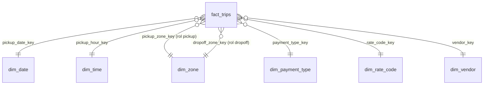

# 08 - Data mart dimensional en Gold (Finanzas TLC)

Modelo estrella para el área de Finanzas, construido desde silver. Esta carpeta va dentro de
`modules/06-end-to-end-nyc-taxi/`, al lado de `03-gold/`, para que el `%run ../00-setup/config` funcione.

## Antes de correr

1. `00-setup/config.py` ya tiene `CATALOG = "20080_databricks"`, `SCHEMA = "stefany_morelos"` y las constantes
   `T_DM_*` del mart.
2. Corre antes `00-setup/01_create_catalog`, `01-bronze/` (ene–jun 2024) y `02-silver/`.

## Orden de ejecución

| # | Notebook | Parte del ejercicio | Va en el workflow |
|---|---|---|---|
| — | `_dm_common.py` | Utilidades. No se corre solo: lo importan los demás con `%run` | — |
| 1 | `01_dm_dimensiones.py` | Parte 0 (diseño) + Parte 1 (6 dimensiones) | ✅ `dm_dimensions` |
| 2 | `02_dm_fact_trips.py` | Parte 2 (hechos, nulos, **conciliación**) + 5.3 (liquid clustering) | ✅ `dm_fact_trips` |
| 3 | `03_dm_constraints_vistas_permisos.py` | Parte 3 (PK/FK, vistas, permisos) | ✅ `dm_constraints_views` |
| 4 | `04_dm_preguntas_negocio.py` | Parte 4 (6 preguntas, solo con el mart) | ❌ análisis |
| 5 | `05_dm_rendimiento_orquestacion.py` | Parte 5 (silver vs. estrella) + Parte 6 (DAG) | ❌ análisis |
| — | `prueba_companero.sql` | Lo corre tu compañero en la Parte 3.3 | — |
| — | `ENUNCIADO_exercise_datamart.md` | Enunciado del ejercicio | — |

## Lo que tienes que completar tú

- **Notebook 03, widget `companero`:** el correo de tu compañero. Después pega en la celda de evidencia la salida de
  `SHOW GRANTS` y el error que él recibió.
- **Notebooks 04 y 05:** las cifras marcadas con ✏️ en las celdas de interpretación y tus tiempos.

## Si cambias el esquema de alguna tabla

Corre `01_dm_dimensiones` con el widget `reset_mart = true` una vez. Eso borra y recrea el mart. Después corre
`02` y `03`.

## Diagrama

